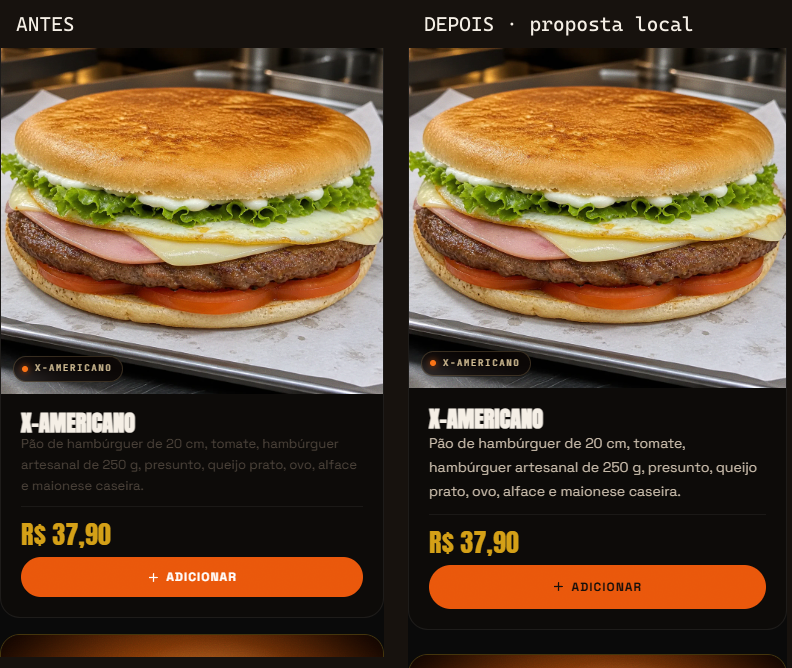
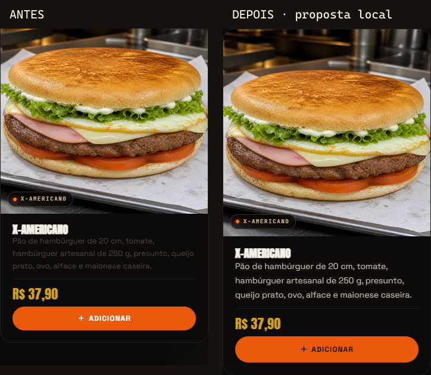

# Cardápio — revisão visual incremental

Descrições antes em marrom escuro e limitadas a três linhas passam a ter contraste maior, 14 px, entrelinha de 1,7 e conteúdo completo. Filtros e botões do cardápio usam texto escuro sobre laranja, alvo mínimo de 44 px e foco explícito. Categorias com um ou dois cards ficam centralizadas sem ampliar exageradamente as imagens. Bebidas usam uma coluna nas telas menores que 400 px.

| Medição local em Chromium | Antes | Depois |
| --- | --- | --- |
| Contraste mínimo das descrições | 1,91:1 | 9,49:1 |
| Texto de filtros ativos e botões laranja | 3,56:1 | 5,33:1 |
| Altura dos filtros | 31 px | 44 px |

Valores calculados pelas cores computadas do navegador. Não representam certificação de acessibilidade integral. Validado em 360, 390, 768 e 1440 px: 16 verificações após o ajuste; 92 testes automatizados, zero falhas; um teste externo opcional ignorado; build aprovado. O ensaio de referência anterior contém 12 medições, incluindo os problemas conhecidos, e não é uma aprovação do visual anterior.

As três fotos aprovadas dos combos, incluindo as latinhas Sanka, permanecem idênticas em bytes. Não há novos preços, receitas, imagens comerciais ou alterações no núcleo de checkout. O teste de navegador simula erro de API e verifica carrinho preservado, retirada gratuita e delivery com taxa pendente. Não grava pedidos, não envia mensagens e não acessa banco.

Reprodução: após o build, executar `node scripts/menu-visual-qa.cjs` com Playwright instalado à parte. Variáveis opcionais documentadas no cabeçalho do script: caminho de Playwright, navegador, raiz de comparação e destino das evidências. A execução é somente local.

Merge e publicação aguardam autorização específica, pois master dispara deploy automático. A branch deste pacote tem deploy automático desabilitado no arquivo versionado, sem alterar configurações remotas da Vercel.

Rollback: antes do merge, basta manter o PR aberto ou fechá-lo. Após eventual publicação autorizada, preparar reversão do merge ou retorno ao deployment anterior conferido, mediante aprovação. Nenhuma migration ou reversão de banco está envolvida.
